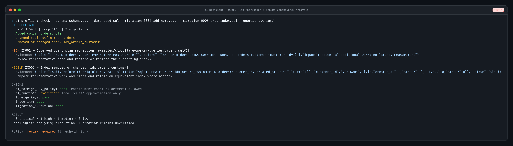
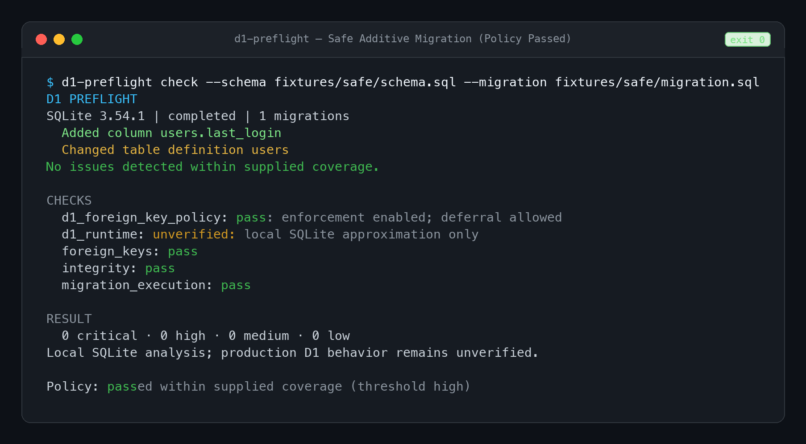
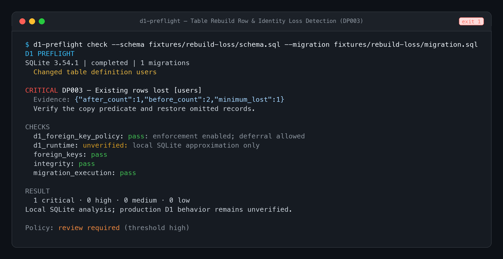
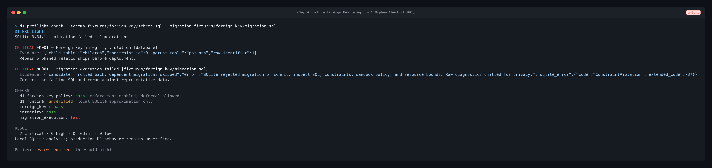
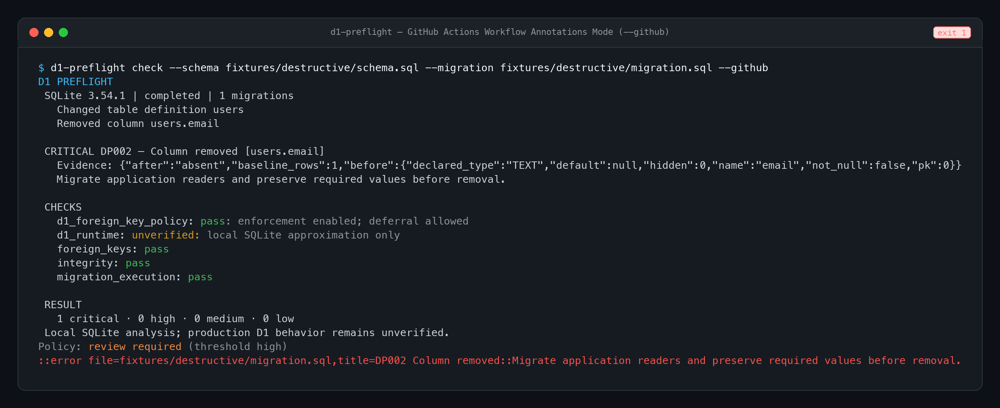

# D1 Preflight

Offline migration safety analysis for Cloudflare D1. `d1-preflight` applies pending SQL to disposable SQLite snapshots, compares schemas and row identities, validates referential constraints, and evaluates workload query plan regressions before deployment.



SQL migrations can execute successfully against an engine while silently breaking production applications: removing a column still referenced by active workers, losing a uniqueness guarantee, causing silent row loss during table rebuilds, or turning an indexed lookup into an unbounded table scan. Preflight detects these consequences entirely offline, providing actionable evidence, severity levels, migration file attribution, and review guidance.

This is a standalone Rust CLI tool. It does not contact Cloudflare, invoke Wrangler, modify production databases, or require access tokens. SQLite evaluation approximates D1 behavior; query plans are structural observations rather than latency benchmarks.

---

## Showcase & Demonstration Gallery

### 1. Query Plan Regression Detection (Overview)

When a migration drops or modifies a supporting index, workload queries that previously executed as selective index lookups can regress to full table scans. Preflight evaluates `EXPLAIN QUERY PLAN` for supplied application workloads and flags regressions with exact before/after plan diffs:


### 2. Safe Additive Migration

Clean additive schema changes (such as adding nullable columns or non-destructive tables) pass verification without false positives:



### 3. Rebuild Row & Identity Loss

Table rebuild migrations (`CREATE TABLE new ... INSERT INTO new SELECT ... DROP old ... RENAME new TO old`) are compared against row counts and primary key identities to catch copy predicate omissions and accidental data loss:



### 4. Foreign Key Integrity Violations

SQLite foreign key constraints are enforced throughout execution. Orphaned child records or broken relationship definitions fail immediate validation and report constraint IDs and table locations:



### 5. GitHub Actions & CI Integration

Using the `--github` flag emits formatted GitHub workflow annotations (`::error`, `::warning`) and appends Markdown summaries directly to `$GITHUB_STEP_SUMMARY`:



---

## Key Features

- **Offline Execution:** Self-contained Rust CLI with bundled SQLite. Runs without network access, credentials, or Cloudflare infrastructure.
- **Query Plan Regression Detection (`IX002`, `QP001`):** Analyzes `EXPLAIN QUERY PLAN` on supplied SELECT workloads before and after migrations, flagging transitions from `SEARCH` to `SCAN`, temporary sort B-trees, or automatic indexing.
- **Destructive Change Auditing (`DP001`–`DP003`):** Detects dropped tables, dropped columns, row count decreases, and lost bounded primary key identities during rebuilds.
- **Schema & Constraint Evolution (`SC001`–`SC005`):** Flags modified column nullability (e.g. introducing `NOT NULL` without defaults), type changes, modified primary key sequences, and removed unique index guarantees.
- **Strict Foreign Key Enforcement (`FK001`, `FK002`):** Runs migrations under SQLite foreign key checks and audits changed relationships, matching D1's enforcement model.
- **Unbounded Mutation Detection (`SQ001`):** Statically parses migrations to flag top-level `UPDATE` or `DELETE` statements lacking a `WHERE` clause.
- **Wrangler Integration:** Automatically extracts migration directory and table settings from `wrangler.toml` via `--wrangler-config`.
- **Structured Reporting:** Produces human-readable terminal output, detailed versioned JSON reports (`--json-out`), and concise GitHub Markdown reviews (`--markdown-out`).

---

## Installation

Requirements: A modern stable Rust toolchain and a C compiler for bundled SQLite. No external SQLite system libraries are required.

```sh
# Clone and build
git clone https://github.com/ranajahanzaib/d1-preflight.git
cd d1-preflight

# Build optimized release binary
cargo build --release --locked

# Optionally install into Cargo bin
cargo install --path . --locked

# Verify installation
./target/release/d1-preflight --help
```

---

## Quick Start

### Safe Migration (Exit 0)

Verify a non-destructive column addition:

```sh
d1-preflight check \
  --schema fixtures/safe/schema.sql \
  --migration fixtures/safe/migration.sql
```

Output:

```text
D1 PREFLIGHT
SQLite 3.54.1 | completed | 1 migrations
  Added column users.last_login
  Changed table definition users
No issues detected within supplied coverage.

CHECKS
  d1_foreign_key_policy: pass: enforcement enabled; deferral allowed
  d1_runtime: unverified: local SQLite approximation only
  foreign_keys: pass
  integrity: pass
  migration_execution: pass

RESULT
  0 critical · 0 high · 0 medium · 0 low
Local SQLite analysis; production D1 behavior remains unverified.

Policy: passed within supplied coverage (threshold high)
```

### Plan Regression Check (Exit 1)

Analyze a migration that drops an index used by an active workload:

```sh
d1-preflight check \
  --schema fixtures/performance/schema.sql \
  --migration fixtures/performance/migration.sql \
  --queries fixtures/performance/query.sql \
  --json-out reports/preflight.json \
  --markdown-out reports/preflight.md
```

Output:

```text
D1 PREFLIGHT
SQLite 3.54.1 | completed | 1 migrations
  Removed or changed index idx_orders_customer

HIGH IX002 — Observed query plan regression [fixtures/performance/query.sql#1]
  Evidence: {"after":["SCAN orders"],"before":["SEARCH orders USING INDEX idx_orders_customer (customer_id=?)"],"impact":"potential additional work; no latency measurement"}
  Review representative data and restore or replace the supporting index.

MEDIUM IX001 — Index removed or changed [idx_orders_customer]
  Evidence: {"after":null,"before":{"origin":"c","partial":false,"sql":"CREATE INDEX idx_orders_customer ON orders(customer_id)","terms":[[1,"customer_id",0,"BINARY",1],[-1,null,0,"BINARY",0]],"unique":false}}
  Compare representative workload plans and retain an equivalent index where needed.

CHECKS
  d1_foreign_key_policy: pass: enforcement enabled; deferral allowed
  d1_runtime: unverified: local SQLite approximation only
  foreign_keys: pass
  integrity: pass
  migration_execution: pass

RESULT
  0 critical · 1 high · 1 medium · 0 low
Local SQLite analysis; production D1 behavior remains unverified.

Policy: review required (threshold high)
```

---

## Baseline Sources & Pending Selection

Choose exactly one baseline input:

```sh
# Approach A: Baseline SQL schema with seed rows + explicit migration
d1-preflight check \
  --schema schema.sql \
  --data seed.sql \
  --migration migrations/0002_update_orders.sql

# Approach B: SQLite snapshot database + migration directory
d1-preflight check \
  --db snapshot.sqlite \
  --migrations-dir migrations \
  --queries queries/
```

- `--migration`: Repeatable flag. Files are applied in lexicographical order.
- `--migrations-dir`: Discovers pending files using the database tracking table (`d1_migrations` by default) or a configured `after` boundary.
- `--db`: Read-only snapshot of an existing SQLite database using SQLite's backup API, preserving committed WAL state without modifying the source file.
- `--queries`: Directory or file containing representative application queries. Queries are planned using `EXPLAIN QUERY PLAN` with null parameter bindings; queries are never executed.

---

## Finding Rules Reference

| Rule ID | Default Severity | Category    | Trigger & Description                                                                     |
| ------- | ---------------- | ----------- | ----------------------------------------------------------------------------------------- |
| `DP001` | Critical         | Destructive | Table removed in candidate schema; application reads/writes will fail.                    |
| `DP002` | Critical         | Destructive | Column removed from table; existing application queries will fail.                        |
| `DP003` | Critical         | Destructive | Existing row count decreased or bounded primary keys disappeared during rebuild.          |
| `SC001` | High             | Schema      | Column definition, strictness, or storage type altered.                                   |
| `SC002` | High             | Schema      | `NOT NULL` constraint introduced without default, or new required column added.           |
| `SC003` | High             | Schema      | Primary key columns or sequence changed.                                                  |
| `SC004` | Medium           | Schema      | Column default expression changed.                                                        |
| `SC005` | High             | Schema      | Unique constraint or index removed without an equivalent replacement.                     |
| `FK001` | Critical         | Integrity   | Foreign key violation observed via `PRAGMA foreign_key_check`.                            |
| `FK002` | High             | Integrity   | Foreign key definition removed or altered.                                                |
| `IX001` | Medium           | Performance | Index removed, altered, or replaced.                                                      |
| `IX002` | High             | Performance | Query plan regression: `SEARCH` turned into `SCAN`, temporary sort B-tree, or auto-index. |
| `QP001` | Medium           | Performance | Unindexed full table scan detected in workload query.                                     |
| `QP002` | Critical         | Performance | Workload query prepared on baseline but fails to prepare on candidate.                    |
| `SQ001` | High             | Mutation    | Top-level `UPDATE` or `DELETE` statement lacks a `WHERE` clause.                          |
| `OB001` | Medium           | Objects     | Database view or trigger removed or changed.                                              |
| `MG001` | Critical         | Execution   | Migration execution failed, transaction escaped, or integrity check failed.               |

Detailed rule rationale and handling guidelines are documented in [docs/rules.md](docs/rules.md).

---

## Configuration (`d1-preflight.toml`)

Preflight automatically loads `d1-preflight.toml` if present in the working directory:

```toml
[analysis]
fail_on = "high"             # Policy threshold: "low", "medium", "high", or "critical"
check_foreign_keys = true
check_integrity = true
check_query_plans = true

[migrations]
directory = "migrations"
tracking_table = "d1_migrations"
# after = "0001_initial.sql" # Required when using schema + directory discovery

[queries]
directory = "queries"

[report]
json = "reports/preflight.json"
markdown = "reports/preflight.md"

[rules]
IX001 = "medium"
IX002 = "high"
```

### Wrangler TOML Integration

When integrating with a Cloudflare Worker project using `wrangler.toml`:

```sh
d1-preflight check \
  --schema schema.sql \
  --wrangler-config wrangler.toml \
  --binding DB \
  --migration migrations/0002_add_feature.sql \
  --queries queries/
```

Preflight reads `migrations_dir`, `migrations_table`, and `migrations_pattern` directly from the binding configuration.

---

## CI / GitHub Actions

Integrate `d1-preflight` into pull request workflows to catch migration issues before merging:

```yaml
name: Database Preflight
on: [pull_request]

jobs:
  preflight:
    runs-on: ubuntu-latest
    steps:
      - uses: actions/checkout@v4

      - uses: dtolnay/rust-toolchain@stable

      - name: Build D1 Preflight
        run: cargo build --release --locked

      - name: Run Migration Safety Checks
        run: |
          ./target/release/d1-preflight check \
            --schema schema.sql \
            --data seed.sql \
            --migrations-dir migrations \
            --queries queries/ \
            --json-out reports/preflight.json \
            --markdown-out reports/preflight.md \
            --github \
            --fail-on high
```

### Exit Codes

| Exit Code | Meaning                                                                                          |
| :-------: | ------------------------------------------------------------------------------------------------ |
|    `0`    | All migrations applied successfully; findings are below failure threshold.                       |
|    `1`    | Policy failure: findings equal to or above `--fail-on` threshold, or migration execution failed. |
|    `2`    | Invalid input: missing file, invalid configuration, or duplicate migration paths.                |
|    `3`    | Internal or report write failure.                                                                |

---

## Limitations

- **Local Approximation:** SQLite execution approximates Cloudflare D1. Service-specific features, D1 distribution semantics, and runtime parameter limitations may differ.
- **Synthetic Data vs Production:** Local seed rows cannot prove production concurrency safety. Parameters in workload queries are bound to `NULL` for planning.
- **Transaction Model:** Migrations run with implicit per-file transactions matching D1 conventions. Explicit `BEGIN`, `COMMIT`, or `SAVEPOINT` statements are conservatively rejected.
- For complete architecture and limitations, see [docs/architecture.md](docs/architecture.md) and [docs/limitations.md](docs/limitations.md).

---

## Development & Verification

To verify formatting, linter warnings, unit tests, and integration tests:

```sh
# Format check
cargo fmt --all -- --check

# Clippy linter
cargo clippy --all-targets --all-features -- -D warnings

# Run all test suites
cargo test --all-features

# Build release binary
cargo build --release
```

---


## License & Custom Work

[](mailto:work@withrana.com) [](https://www.linkedin.com/in/workwithrana)
[](https://www.upwork.com/freelancers/~01bbcf6edb91a8df5f)
[](https://contra.com/ranajahanzaib/)

**License:** MIT, see [LICENSE](LICENSE). Free for personal and commercial use.

**Author:** Rana Jahanzaib

**Need this built for your stack?** Email me what you're working on: work@withrana.com
